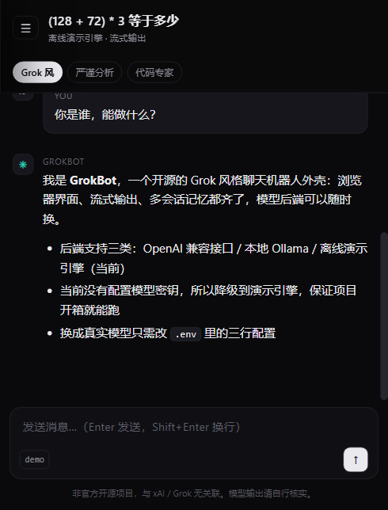

# GrokBot

一个**能立刻跑起来**的 Grok 风格开源 AI 聊天机器人：单页网页界面、流式输出、多会话记忆，
模型后端可换（OpenAI 兼容接口 / 本地 Ollama / 离线演示引擎）。

> 本项目是个人开源作品，**与 xAI 及 Grok 官方无任何关联**，仅为致敬其交互风格的独立实现。
> 仓库里不含任何模型权重——「大脑」由你自己接的模型提供。

```
Python 3.10+ · FastAPI · SQLite · 零前端依赖 · 44 项自动化测试
```

## 界面预览



> 截图取自未接入任何模型时的默认状态：侧栏底部会写明当前后端，右下角 `demo` 标签提示这是离线演示引擎。

---

## 它解决了什么问题

大多数人想跑一个 ChatGPT / Grok 那样的对话界面时，卡在同一件事上：**没有 API Key 就什么都打不开**。
所以这个项目默认带一个「离线演示引擎」：没有任何 Key 的情况下也能启动、能对话、能算数，
界面、流式渲染、会话存储全部是真实可用的链路。等你填上 Key，同一套界面直接换成真模型。

## 特性

- **流式输出**：服务端 SSE 逐字下发，前端边收边渲染，带闪烁光标
- **三类后端，一个界面**：任意 OpenAI 兼容接口、本地 Ollama、离线演示引擎，自动降级
- **启动即自检**：`auto` 模式会探测 Ollama 是否在线、**目标模型是否已拉取**，避免「连上了却报 model not found」
- **多会话 + 本地持久化**：SQLite 存会话与消息，侧栏可切换、重命名、删除，标题自动取自首条消息
- **三种人格**：Grok 风（直率、带点毒舌）、严谨分析、代码专家，切人格即时生效
- **零前端依赖**：没有 CDN、没有构建步骤，`static/` 里就是纯 HTML/CSS/JS，自带精简 Markdown 渲染（含代码块、表格、列表）
- **安全默认值**：只做算术的 `safe_eval` 用 AST 白名单而非 `eval`；Markdown 渲染先转义再做行内语法；密钥只从环境变量读取，永不落盘

## 快速开始

```bash
git clone https://github.com/<你的用户名>/grok-bot.git
cd grok-bot

python -m venv .venv
# Windows
.venv\Scripts\activate
# macOS / Linux
source .venv/bin/activate

pip install -r requirements.txt
uvicorn app.main:app --reload
```

打开 <http://127.0.0.1:8000> 即可对话。没配 Key 时你会看到侧栏底部标注「离线演示引擎」。

懒人版脚本（自动建虚拟环境、装依赖、启服务）：

```powershell
# Windows
powershell -ExecutionPolicy Bypass -File scripts\run.ps1
```

```bash
# macOS / Linux
bash scripts/run.sh
```

## 接入真实模型

复制配置模板，按需改三行：

```bash
cp .env.example .env
```

### 方案 A：任意 OpenAI 兼容接口（推荐）

```dotenv
GROKBOT_PROVIDER=openai
OPENAI_BASE_URL=https://api.openai.com/v1
OPENAI_API_KEY=sk-xxxxxxxx
OPENAI_MODEL=gpt-4o-mini
```

因为走的是标准 `/chat/completions` 协议，DeepSeek、通义千问、Moonshot、自建 vLLM / one-api 都能直接用，只改 `BASE_URL` 和模型名：

```dotenv
# DeepSeek
OPENAI_BASE_URL=https://api.deepseek.com/v1
OPENAI_MODEL=deepseek-chat

# 阿里云通义（兼容模式）
OPENAI_BASE_URL=https://dashscope.aliyuncs.com/compatible-mode/v1
OPENAI_MODEL=qwen-plus
```

### 方案 B：本地 Ollama（完全离线，不需要 Key）

```bash
ollama serve                 # 默认监听 127.0.0.1:11434
ollama pull qwen2.5:7b
```

```dotenv
GROKBOT_PROVIDER=ollama
OLLAMA_MODEL=qwen2.5:7b
```

### 方案 C：不配置，直接跑演示引擎

```dotenv
GROKBOT_PROVIDER=demo
```

演示引擎**不是语言模型**，它会诚实地告诉你它答不了，而不是编造一个像样的假答案。它只擅长两件事：算术计算，以及给出结构化回答骨架。

### `auto` 模式的判定顺序

`GROKBOT_PROVIDER=auto`（默认）时：

1. 有 `OPENAI_API_KEY` → 用 OpenAI 兼容接口
2. 否则探测 `OLLAMA_BASE_URL`：在线**且已拉取 `OLLAMA_MODEL`** → 用 Ollama
3. 否则 → 离线演示引擎，并在界面底部写明降级原因

## 配置项

| 变量 | 默认值 | 说明 |
| --- | --- | --- |
| `GROKBOT_PROVIDER` | `auto` | `auto` / `openai` / `ollama` / `demo` |
| `OPENAI_BASE_URL` | `https://api.openai.com/v1` | 兼容接口基址，需含 `/v1` |
| `OPENAI_API_KEY` | 空 | 接口密钥；不要提交进 Git |
| `OPENAI_MODEL` | `gpt-4o-mini` | 模型名 |
| `OLLAMA_BASE_URL` | `http://127.0.0.1:11434` | 本地 Ollama 地址 |
| `OLLAMA_MODEL` | `qwen2.5:7b` | 本地模型 tag |
| `GROKBOT_HOST` / `GROKBOT_PORT` | `127.0.0.1` / `8000` | 监听地址与端口 |
| `GROKBOT_TEMPERATURE` | `0.7` | 采样温度 |
| `GROKBOT_MAX_TOKENS` | `1024` | 单次回复上限 |
| `GROKBOT_TIMEOUT` | `120` | 上游请求超时（秒） |
| `GROKBOT_HISTORY_LIMIT` | `20` | 送进模型的历史消息条数 |
| `GROKBOT_DB` | `data/grokbot.db` | SQLite 路径 |

环境变量优先级高于 `.env`，方便在容器里覆盖。

## HTTP 接口

| 方法 | 路径 | 说明 |
| --- | --- | --- |
| GET | `/api/health` | 存活探针，返回当前 provider / model |
| GET | `/api/config` | 后端信息、人格列表、降级原因 |
| GET | `/api/conversations` | 会话列表（按最近活动排序） |
| POST | `/api/conversations` | 新建会话 |
| GET | `/api/conversations/{id}` | 会话详情（含全部消息） |
| PATCH | `/api/conversations/{id}` | 重命名 |
| DELETE | `/api/conversations/{id}` | 删除会话及其消息 |
| POST | `/api/chat` | 流式对话，`text/event-stream` |

`POST /api/chat` 的 SSE 事件：

| 事件 | 载荷 | 时机 |
| --- | --- | --- |
| `meta` | `conversation_id` `title` `provider` `model` `persona` | 首帧，会话已落库 |
| `delta` | `text` | 每个增量片段 |
| `done` | `conversation_id` `title` `characters` | 正常结束 |
| `error` | `message` `hint` | 上游失败，`hint` 给出排查方向 |

命令行试一下：

```bash
curl -N -X POST http://127.0.0.1:8000/api/chat \
  -H "Content-Type: application/json" \
  -d '{"message": "(128 + 72) * 3 等于多少", "persona": "grok"}'
```

## 项目结构

```
grok-bot/
├── app/
│   ├── config.py      # .env 解析与配置快照
│   ├── prompts.py     # 三种人格的系统提示
│   ├── providers.py   # OpenAI 兼容 / Ollama / 演示引擎 + 自动降级
│   ├── store.py       # SQLite 会话与消息
│   ├── schemas.py     # Pydantic 请求/响应模型
│   └── main.py        # FastAPI 路由与 SSE 流
├── static/            # 单页界面（纯 HTML/CSS/JS，无依赖）
├── tests/             # 35 项 pytest 用例
├── scripts/           # 一键启动脚本
├── Dockerfile
└── .env.example
```

## 测试

```bash
pip install -r requirements-dev.txt
python -m pytest
```

覆盖范围：算术求值白名单、OpenAI/Ollama 流式解析、上游错误透出、演示引擎输出、
SQLite 增删改查与排序、会话生命周期接口、SSE 事件序列与落库一致性。

## Docker

```bash
docker build -t grok-bot .
docker run --rm -p 8000:8000 -e OPENAI_API_KEY=sk-xxx -v "$PWD/data:/app/data" grok-bot
```

## 常见问题

**打开页面显示「离线演示引擎」？** 侧栏底部会写出具体原因。常见三种：没填 Key；Ollama 没启动；Ollama 在线但没拉取对应模型（执行 `ollama pull qwen2.5:7b`，或在 `.env` 里把 `OLLAMA_MODEL` 改成已有模型）。

**改了 `.env` 不生效？** 配置在启动时读取，改完需要重启 `uvicorn`。

**回答中途报 401 / 404？** 401 多为 Key 无效；404 多为 `OPENAI_BASE_URL` 少了 `/v1`，或模型名拼错。界面会把上游原始信息透出来。

**想换端口？** `uvicorn app.main:app --port 9000`，或设 `GROKBOT_PORT`。

**数据存哪？** `data/grokbot.db`，已在 `.gitignore` 里排除。删掉它就等于清空全部会话。

## 许可

MIT，见 [LICENSE](LICENSE)。
